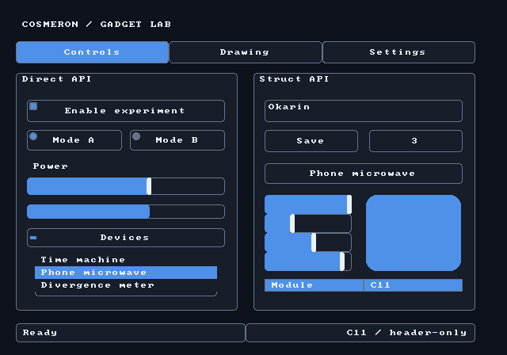

# Cosmeron GUI Lab

```sh
cc -std=c11 -D_POSIX_C_SOURCE=200809L Codespace/Examples/GUI/Lab.c -o lab
./lab
./lab --frames 3
./lab --ppm preview.ppm
```

The application demonstrates direct and Ex widgets, native events, explicit
presentation, surface resize, theme defaults and a Chronometry frame limiter.
The PPM path needs no display or native window backend.

X11 needs development headers and an available X server/XWayland. Win32 uses
system DLLs dynamically. Other hosts can supply Window_TAdapter callbacks.


