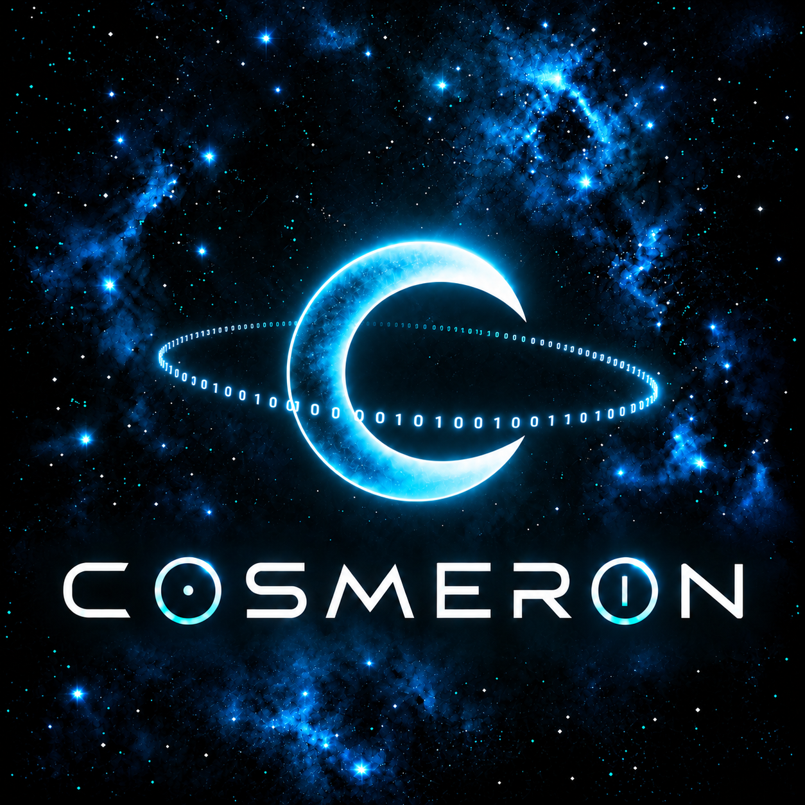

  

# Documentación de Cosmeron

Este directorio contiene la documentación del proyecto en español latinoamericano.

## Estructura

- [Gobernanza](Governance/): autoría, contribución, soporte, código de conducta y seguridad.
- [Proyecto](Project/): dirección, hoja de ruta, versiones y decisiones técnicas.
- [Módulos](Modules/): referencia de la API de los módulos refactorizados en `Codespace/Cosmeron/`.
- [Referencia](Reference/): convenciones técnicas transversales.

## Documentación de los módulos

- **Core**: [Algorithm](Modules/Algorithm.md) · [Bit](Modules/Bit.md) · [Cast](Modules/Cast.md) · [Condition](Modules/Condition.md) · [Diagnostic](Modules/Diagnostic.md) · [Memory](Modules/Memory.md) · [Module](Modules/Module.md) · [Preprocessor](Modules/Preprocessor.md) · [Types](Modules/Types.md)
- **Modules**: [Chronometry](Modules/Chronometry.md) · [Container](Modules/Container.md) · [Math](Modules/Math.md) · [Numeric](Modules/Numeric.md) · [Text](Modules/Text.md) · [Tuple](Modules/Tuple.md)

La documentación original en inglés está en [../en/README.md](../en/README.md). La versión en portugués está en [../pt/README.md](../pt/README.md).
